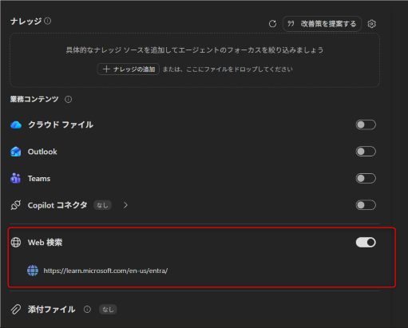

# よりスムーズな問題解決のために：お問い合わせ前に役立つ公開情報

こんにちは、 Entra ID サポート チームの小出です。

今回は、弊社サポートにお問い合わせを起票いただく前にご利用いただける、公開情報やブログ情報などを紹介いたします。

## はじめに

いつも多くのお問い合わせを弊社サポートにお寄せいただき誠にありがとうございます。

サポートをご利用いただくなかで、下記のような経験をお持ちのお客様もいらっしゃるかと思います。

- お問い合わせを起票し、回答を待っている間に AI に聞いてみたら自己解決できた
- サポートからの回答を確認したら、サポート ブログの方で既に公開されている情報だった
- 発生したエラーについて検索してみたところ、同じような事象と対処策についての情報が出てきたが、公開情報ではないので信頼していいのかわからない
- 似たような事象がコミュニティ サイトにあったが英語なのでわかりにくい

弊社サポートにおきましても、可能な限り迅速にお客様への連絡や回答を案内できるよう努めておりますが、
お客様がよりスムーズに問題を解決できるよう、お問い合わせを起票いただく前にお客様側にて利用いただける情報についておまとめいたしました。

また、Microsoft 365 Copilot をはじめ、 AI を活用いただいているお客様や、今後利用したいと考えているお客様向けに、 AI エージェントでの利用方法についても後半にてご案内いたしております。
下記に紹介いたします公開情報やブログなどを利用し "エージェント" を活用いただけますと、エージェントに質問することで一次回答や情報採取の情報を確認でき、お客様ご自身でスムーズに問題や疑問点を解決いただけます。

具体的なエージェントのプロンプト詳細につきましては、お客様環境によって設定や指示が異なる点もございますため本記事では割愛いたしますが、応答のソースとなるサイトの指定方法などを後半に案内いたしておりますので、生成 AI を活用いただくうえでも参考になりましたら幸いです。

なお、本記事では Entra ID の内容に限らず、 セキュリティ関連製品について記載いたしております。Intune や Microsoft Defender をはじめとするセキュリティ製品をご利用のお客様も、ぜひご利用ください。

<!-- more -->

## 目次

1. [各製品ごとの推奨公開情報の紹介](#idx1)
	- [Microsoft Entra ID ](#idx1-1)
	- [Microsoft Intune)](#idx1-2)
	- [Configuration Manager (SCCM)](#idx1-3)
    - [Security (Microsoft Defender / Microsoft Sentinel / Security platform)](#idx1-4)
    - [Compliance](#idx1-5)

2. [エージェントでの活用方法について](#idx2)
    - [エージェントにおけるソースの指定方法について](#idx2-1)
    - [本ブログにおけるエージェント構築時のおすすめ参照順について](#idx2-2)

<h2 id="idx1">各製品ごとの推奨公開情報の紹介</h2>

弊社におけるセキュリティ関連製品には、主に 5 種類のカテゴリがございます。トラブル シューティングや製品の情報を確認されたいときにご利用いただける推奨情報を、下記に製品ごとにご案内いたします。

<h3 id="idx1-1">Microsoft Entra ID </h3>

Microsoft Entra ID は、各製品への認証やアカウント管理を担う機能です。動作の詳細や手順などをご案内しておりますドキュメントのほか、トラブル シューティング用のガイドもございます。公開情報で網羅できていないトラブル シューティングやよくある質問を、日本語の技術情報としてブログでもご案内いたしておりますので、日本語の技術情報ブログも、公開情報と同様にご利用いただけます。

| サイト | 用途 | 日本語利用可否 |
|---|---|---|
| [Microsoft Entra ID Documentation](https://learn.microsoft.com/en-us/entra/identity/) | 製品ドキュメント、設計情報 | ○ |
| [Troubleshoot Microsoft Entra Issues](https://learn.microsoft.com/en-us/troubleshoot/entra/welcome-entra) | トラブルシューティング | ○ |
| [Microsoft Entra Releases & Announcements](https://learn.microsoft.com/en-us/entra/fundamentals/whats-new) | 新機能、仕様変更情報 | ○ |
| [Release Archive](https://learn.microsoft.com/en-us/entra/fundamentals/whats-new-archive) | 過去のリリース履歴 | ○ |
| [Japan Azure Identity Support Blog](https://jpazureid.github.io/blog/) | 日本語の技術情報、サポート事例 | ○（日本語のみ） |
| [Microsoft Security Blog](https://www.microsoft.com/security/blog/?p=90101) | セキュリティ関連アップデート | ×（英語のみ） |

<h3 id="idx1-2">Microsoft Intune</h3>

Microsoft Intune は、組織で利用するデバイスやアプリケーションをクラウド上で管理し、組織のデータ保護やセキュリティ対策を支援する製品です。機能の詳細や設定手順、トラブル シューティングをご案内する公開ドキュメントのほか、よくある質問や公開情報を補足する内容を日本語の技術情報ブログでもご案内しておりますので、併せてご利用いただけます。

| サイト | 用途 | 日本語利用可否 |
|---|---|---|
| [Microsoft Intune Documentation](https://learn.microsoft.com/ja-jp/intune/) | Intune の新機能、導入方法、トラブル シューティング全般 | ○ |
| [Microsoft Intune Blog \| Microsoft Community Hub](https://techcommunity.microsoft.com/category/microsoftintune/blog/microsoftintuneblog) | 最新のアップデート、新機能、既知の問題などの Intune ブログ | ×（英語のみ） |
| [Japan Microsoft Intune Support Team Blog](https://jpintune.github.io/blog/) | 日本のお客様向けの技術情報やサポート事例 | ○（日本語のみ） |

<h3 id="idx1-3">Configuration Manager (SCCM)</h3>

Configuration Manager (SCCM) は、組織内のデバイスやアプリケーションを管理するための製品です。アプリケーションや更新プログラムの展開、デバイスの構成管理など、企業内のさまざまなデバイスを効率よく管理・運用するための幅広い機能を提供しています。

各機能の動作やトラブル シューティングについては Microsoft Learn の公開ドキュメントをご利用いただけます。また、よくあるお問い合わせや公開情報を補足する内容を日本語の技術情報ブログでもご案内しておりますので、併せてご利用いただけます。

| サイト | 用途 | 日本語利用可否 |
|---|---|---|
| [Configuration Manager Troubleshooting (Microsoft Learn)](https://learn.microsoft.com/troubleshoot/mem/configmgr/) | トラブルシューティング、障害対応 | ○ |
| [Japan MEM Support Blog](https://jpmem.github.io/blog/categories/Configuration-Manager/) | 日本語の技術情報、サポート事例 | ○（日本語のみ） |

<h3 id="idx1-4">Security (Microsoft Defender / Microsoft Sentinel / Security platform)</h3>

**Defender / Security Platform**

Microsoft Defender は、エンドポイント、ID、電子メール、クラウドアプリケーションなどに対する脅威の検出、防止、調査、対応を担う機能です。
動作の詳細や手順などをご案内しておりますドキュメントのほか、トラブル シューティング用のガイドもございます。公開情報で網羅できていないトラブル シューティングやよくある質問を、日本語の技術情報としてブログでもご案内いたしておりますので、日本語の技術情報ブログも、公開情報と同様にご利用いただけます。
さまざまな領域から得られるセキュリティ情報を集約し、脅威の検出、調査、対応を行うための基盤として Security Platform のひとつと呼ばれる事もあります。
Microsoft Defender ポータルを中心とした各機能の設定や連携、インシデントやアラートの管理などについて、公開ドキュメントや技術情報をご案内しています。

**Microsoft Sentinel**

Microsoft Sentinel は、さまざまな製品やサービスからセキュリティに関するログやデータを収集し、脅威の検出、調査、対応を行うためのサービスです。
データの収集や分析、インシデントの調査、分析ルールや自動化など、各機能の利用方法やトラブルシューティングについて公開ドキュメントをご用意しています。また、公開情報だけでは分かりにくい内容や、よくあるお問い合わせについては、日本語の技術情報ブログでもご案内しています。

| サイト | 用途 | 日本語利用可否 |
|---|---|---|
| [Security 日本語 Blog](https://jp-sec.github.io/blog/) | 日本語の技術情報、サポート情報 | ○（日本語のみ） |
| [Microsoft Community Hub](https://techcommunity.microsoft.com/) | 技術コミュニティ、ナレッジ共有 | ×（英語のみ） |
| [Microsoft Security Community Blog](https://techcommunity.microsoft.com/category/microsoft-security-product/blog/microsoft-security-blog) | Security 製品全般の技術情報 | ×（英語のみ） |
| [Microsoft Sentinel Blog](https://techcommunity.microsoft.com/category/microsoft-sentinel/blog/microsoftsentinelblog) | Sentinel 関連情報 | ×（英語のみ） |
| [Microsoft Security Response Center (MSRC)](https://www.microsoft.com/en-us/msrc) | セキュリティ情報、アドバイザリ | ×（英語のみ） |
| [Security Update Guide](https://msrc.microsoft.com/update-guide/) | CVE、脆弱性情報 | ×（英語のみ） |
| [Antimalware and cybersecurity portal - Microsoft Security Intelligence](https://www.microsoft.com/en-us/wdsi/) | 脅威インテリジェンス | ×（英語のみ） |

<h3 id="idx1-5">Compliance</h3>

editing...

<h2 id="idx2">エージェントでの活用方法について</h2>

お問い合わせを起票いただく前に、お客様側にてご利用いただける公開情報やブログなどについて上記案内いたしましたが、
公開情報やブログをひとつずつ確認いただくのは時間も手間もかかり、ほしい情報を見つけ出すのが難しいこともあるかと思います。

Copilot のチャット機能などをすでに利用いただいているお客様も多いかと思いますが、たとえばエージェントを活用すると、指定したナレッジをもとに応答が生成されるため、効率よく情報にたどり着くことを期待できます。

<h3 id="idx2-1">エージェントにおけるナレッジの指定方法について </h3>

最も簡単にエージェントを作成できる方法は、 Microsoft 365 Copilot 内にあるエージェント ビルダーを利用する方法です。
エージェントにどのようにふるまってほしいかという「指示」の具体的な書き方がわからなくても、どのようなエージェントを作成したいかチャットに入力すれば、指示も自動的に生成してくれます。また、プレビューの機能もありどのように動作するかを事前に試すこともできます。[こちらの公開情報](https://learn.microsoft.com/ja-jp/microsoft-365/copilot/extensibility/agent-builder-build-agents) から詳細を確認いただけます。

エージェントを作成するときには、エージェントがどのような情報を探し応答するかの「指示」のほかに、どこから情報をとってくるかを指定する「ナレッジ」の指定項目があります。この項目で、応答のソースとしたい web サイトやファイルを指定することで、指定されたナレッジから情報を取得してくることができます。

具体的には、たとえば Web ページを指定したい場合、 Web 検索の項目をオンにしたうえで、URL を指定します。
下記に記載の通り、 URL のレベルは 2 階層まで指定することができます。個数にも制限があるため、広く情報を収集するエージェントを作成する場合、できるだけ上位の階層（Microsoft Learn であれば個別のページよりも全体のトップのページなど）を指定します。

詳細は [こちらの公開情報](https://learn.microsoft.com/ja-jp/microsoft-365/copilot/extensibility/agent-builder-add-knowledge#public-websites) も併せてご確認ください。

<h3 id="idx2-2">本ブログにおけるエージェント構築時のおすすめ参照順について </h3>

上記の通り、エージェントを作成する際にはナレッジを指定できますが、指定できる数や URL の階層に制限がございます。
実際にエージェントを作成いただく際、どの URL を優先してナレッジに指定すべきか判断に迷う場合には、下記の推奨参照順をご利用ください。

**Agent 構築時の推奨参照順**

1. Microsoft Learn（製品ドキュメント・Troubleshooting）
2. 日本語 Support Blog
3. Product Blog
4. Community Hub
5. MSRC / Security Update Guide 

Agent の回答品質を重視する場合は、Microsoft Learn を優先してナレッジに登録します。 Microsoft Learn はサービスの正式な公開情報となりますので、動作やトラブルシューティングに際し、公式な情報をお探しの際に安心してご利用いただけます。

公開情報に反映されていない新機能の情報や、日本語でよくお問い合わせいただく内容につきましては、別途ブログで案内していることもございます。
公開情報以外の補足情報も含んだ形でエージェントを利用されたい場合には、併せて日本語のサポート ブログや製品ブログの URL もナレッジに登録することで、より幅広い情報を取得することができます。お客様の要望や用途に合わせ、必要に応じて登録いただき、補完情報として活用いただけましたら幸いです。
